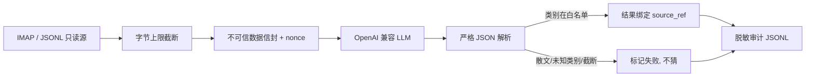

# 架构

## 数据流

## 模块职责

| 模块 | 职责 | 不做什么 |
|---|---|---|
| `sources.py` | 读 JSONL 样本，按字节截断 | 不解析邮件协议 |
| `imap_source.py` | `EXAMINE` + `UID SEARCH` + `BODY.PEEK`，凭据来自环境/文件/钥匙串 | 不发 `STORE`/`COPY`/`MOVE`/`EXPUNGE` |
| `prompt.py` | 构造 system + user 消息，正文放进带 nonce 的信封 | 不把正文拼进规则部分 |
| `client.py` | OpenAI 兼容请求、超时、错误分类、回环默认绕过代理 | 不做重试与降级 |
| `parse.py` | 接受单个 JSON 对象，允许整体代码围栏，校验类别 | 不修补截断 JSON、不从散文猜类别 |
| `runner.py` | 预算、单封失败与整轮中止的区分、结果绑定 | 不让模型提高预算 |
| `audit.py` | 逐事件追加、尽力脱敏 JSONL | 不是完整的敏感信息过滤器 |
| `mcp_server.py` | 只读 MCP 工具表 | 不注册任何写工具 |
| `imap_mailbox.py` | modified UTF-7、IMAP 字符串转义与 LIST 名称解析 | 不持有连接或凭据 |
| `apply.py` | 显式 CLI 目录整理，检查源目录 UIDVALIDITY | 不注册 MCP 写工具、不去重、不自动回滚 |

## 一次运行的生命周期

1. 载入并校验配置（发现凭据字段直接失败）。
2. 取邮件：JSONL 或 IMAP（只读选择）。
3. 每封：截断 → 组装消息 → 调用模型 → 解析 → 校验类别 → 记录审计。
4. 结束：写 `summary.json`，输出表格；失败与中止返回不同退出码（`2` 失败、`3` 中止）。

## 失败分类

| kind | 含义 | 处理 |
|---|---|---|
| `timeout` / `transport` / `http_5xx` / `http_4xx` | 端点不可用或拒绝 | 中止整轮，不重放 |
| `truncated_output` | `finish_reason=length` 且正文为空 | 中止整轮（多为 `max_tokens` 太小） |
| `shape` | 响应结构不符 | 中止整轮 |
| `parse_*` | 单封输出不是合法 JSON 或类别越界 | 只标该封失败，继续下一封 |

## 为什么必须区分「中止」与「单封失败」

端点坏了还继续跑，会把 N 封全部标成同一类失败并消耗预算；而单封输出格式问题不该拖垮整轮。两者混在一起会让结果无法解释。

## 扩展点

- 新增输入源：实现 `read_*` 返回 `EmailRecord` 列表，保持只读。
- 新增模型后端：只要兼容 `/v1/chat/completions`，改 `base_url`/`model` 即可。
- 新增类别：改策略文件，不要改代码。
